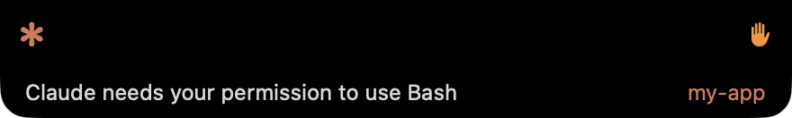
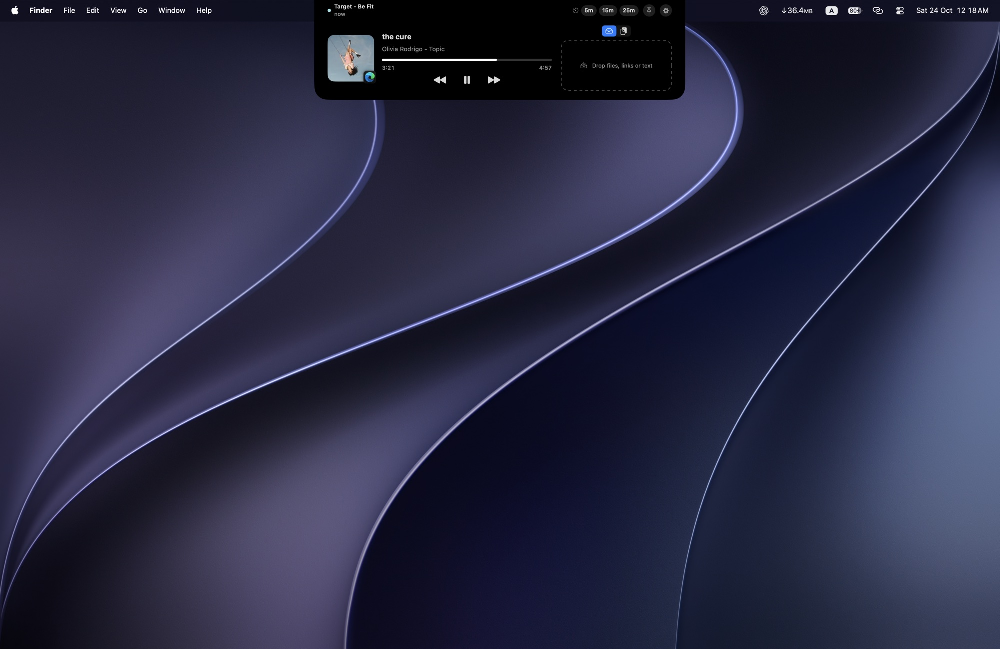
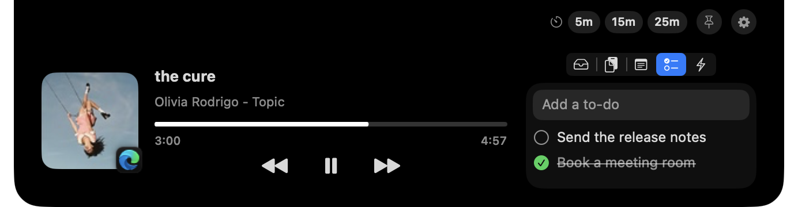

<p align="center">
  <a href="https://github.com/AnushBandara/Dynamic-Iceland/releases/latest">
    
  </a>
</p>

<p align="center">
  <a href="https://github.com/AnushBandara/Dynamic-Iceland/releases/latest"></a>
  
  
  
</p>

<p align="center">
  <a href="#download">Download</a> ·
  <a href="#features">Features</a> ·
  <a href="#claude-code-alerts">Claude Code</a> ·
  <a href="#privacy">Privacy</a> ·
  <a href="#permissions">Permissions</a> ·
  <a href="#faq">FAQ</a> ·
  <a href="#build-from-source">Build from source</a>
</p>

---

**Dynamic Iceland** turns the MacBook notch into a small, live iceland. Music, your next meeting, a timer, a file shelf, clipboard history and quick alerts live right where the notch is, out of the way until you need them.

Hover over the notch to open it, or press <kbd>⌃</kbd> <kbd>⌥</kbd> <kbd>I</kbd> from anywhere. It's a native Mac app with no Dock icon, and it stays idle when nothing is happening.

> [!TIP]
> **New in 1.1: Claude Code alerts.** The iceland now tells you when Claude Code needs your approval, is waiting for your reply, or has finished, with its message right under the notch. Click the alert to jump back to your terminal or editor. [See how it works](#claude-code-alerts).

<p align="center">
  
</p>
<p align="center"><sub>New: Claude Code asking for permission, right under the notch</sub></p>

<p align="center">
  
</p>
<p align="center"><sub>On the desktop: your next meeting, now playing and the shelf, all around the notch</sub></p>

<p align="center">
  
</p>
<p align="center"><sub>Open: now playing, timers and the side column</sub></p>

<p align="center">
  
</p>
<p align="center"><sub>Closed: artwork and a live waveform beside the notch</sub></p>

## Download

1. Download **DynamicIsland-x.y.z.dmg** from the [latest release](https://github.com/AnushBandara/Dynamic-Iceland/releases/latest).
2. Open it and drag the app into **Applications**.
3. Open it from Applications. That's it: hover over the notch.

The app is signed and notarized by Apple, so it opens without warnings. It updates itself from then on.

**Requires** macOS 14 Sonoma or later. Made for MacBooks with a notch; on other Macs it sits at the top centre of the screen.

## Features

### Claude Code alerts

<sup>🆕 New in 1.1</sup>

Using [Claude Code](https://claude.com/claude-code)? Let it work while you do something else: the iceland tells you when it needs you.

| | |
|---|---|
| ✋ **Needs approval** | Claude wants permission to run something, e.g. *"Claude needs your permission to use Bash"*. |
| 💬 **Waiting for you** | Claude has been waiting for your reply. |
| ✅ **Finished** | Claude is done, with the first line of its reply, e.g. *"Fixed the login bug and added a test"*. |

- **Click an alert** to jump straight to the app Claude Code runs in: Terminal, iTerm, VS Code, or the Claude app.
- **Message or icons only.** Show the message under the notch, or keep it to two small icons beside it.
- **The project name** shows next to the message, so you know which session needs you.
- **Turning it on:** the iceland offers it once when it finds Claude Code on your Mac. You can also turn on **Claude Code** in Settings → Alerts. Then restart any open Claude Code sessions.

Works with Claude Code in the terminal, in VS Code and other editors, and in the Claude app's Code tab. Regular chats in the Claude app don't send alerts.

### In the iceland

| | |
|---|---|
| 🎵 **Now playing** | Artwork, play / pause / skip and a timeline you can scrub, for Music, Spotify, browsers, VLC and more. While something plays, the artwork and a live waveform sit beside the notch. |
| 📅 **Calendar** | Your current or next meeting, with a **Join** button for Zoom, Meet and Teams links. |
| ⏱️ **Timer** | 5, 15 and 25 minute timers. The countdown stays beside the notch and chimes when it's done. |
| 📷 **Camera mirror** | Check how you look before a call. The camera turns off as soon as the iceland closes. |
| 📌 **Pin** | Keep the iceland open while you work. It also stays open while you type. |

### The side column

One column, a tab for each tool. Turn off the ones you don't use.

| | |
|---|---|
| 🗂️ **File shelf** | Drop files, links or text on the notch to hold them, and drag them out wherever you need them. Select files to Quick Look, AirDrop or remove them. |
| 📋 **Clipboard history** | Your last 20 copied texts. One click copies one again. |
| 📝 **Notes** | A scratch note, saved as you type. |
| ✅ **To-dos** | A quick checklist. Type, press Return, tick it off. |
| ⚡ **Shortcuts** | Run your favourite Apple Shortcuts with one click. |

Dragging files over the notch also shows an **AirDrop** zone, to send them straight to a nearby device.

### Beside the notch

| | |
|---|---|
| 🔊 **Volume and brightness** | A slim bar beside the notch replaces the big macOS popup. |
| 🔋 **Battery** | The level when you plug in, and a warning at 20% and 10%. |
| 🎧 **Headphones** | AirPods or other Bluetooth headphones connected, with their battery. |
| ⬇️ **Downloads** | A note when a download finishes. |
| 🌙 **Focus** | Do Not Disturb or another Focus turning on or off. |
| ✳️ **Claude Code** | Needs your approval, waiting for you, or finished. [More above](#claude-code-alerts). |

When several things happen at once, the iceland shows the most important first: volume and brightness, then battery, then other alerts, then the timer, then now playing.

## Privacy

Dynamic Iceland is built to be trusted with what's on your screen.

- **Nothing leaves your Mac.** No account, no analytics, no tracking. The only network request is the update check against this repository's releases.
- **Clipboard history stays in memory** and is gone when you quit. Copies that password managers mark as private are skipped.
- **The camera** runs only while the mirror tile is open.
- **Your Downloads folder** is watched for new files; files are never opened or read.
- **Calendar events** are read on your Mac only, to show the next one.
- **Claude Code alerts** are off until you turn them on. Turning them on adds two hooks to `~/.claude/settings.json`, and turning them off removes them; your other settings stay as they are. To show Claude's last reply, the app reads the end of that session's transcript, on your Mac only.

## Permissions

macOS asks for each permission only when you turn on the feature that needs it. **Settings → Permissions** shows what's allowed and opens the right page in System Settings.

| Permission | Used for |
|---|---|
| **Accessibility** | Showing the volume and brightness bar instead of the macOS popup |
| **Calendar** | Showing your next meeting and its Join button |
| **Camera** | The camera mirror, only while it's open |
| **Bluetooth** | Noticing headphones connect and reading their battery |
| **Downloads Folder** | Noticing finished downloads |
| **Full Disk Access** | Focus alerts only. macOS keeps Focus state in a protected folder |

## Keyboard

| Keys | Action |
|---|---|
| <kbd>⌃</kbd> <kbd>⌥</kbd> <kbd>I</kbd> | Open or close the iceland, from anywhere |
| <kbd>Esc</kbd> | Close it, also when pinned |
| <kbd>⇧</kbd> <kbd>⌥</kbd> + volume or brightness keys | Change in finer steps |

Every control has a VoiceOver label, and Reduce Motion and Reduce Transparency are respected.

## FAQ

**Does it work on a Mac without a notch?**
Yes. The iceland sits at the top centre of the screen instead. It's designed around the notch, though.

**Why does it want Full Disk Access?**
Only for Focus alerts. macOS keeps the current Focus in a protected folder, and there's no other way to read it. Skip it if you don't need Focus alerts; everything else works without it.

**Does it slow my Mac down?**
No. It mostly reacts to system events instead of constantly checking, and uses around 1% CPU while music plays.

**How do I hide the menu bar icon?**
Settings → General → Show menu bar icon. To get back to Settings, click the gear in the open iceland, or open the app again from Applications.

**I deleted the app and now Claude Code shows a hook error.**
Turn off **Claude Code** in Settings → Alerts before deleting the app, and it removes its hooks. If the app is already gone, open `~/.claude/settings.json` and delete the two hooks whose command ends in `--claude-hook` (under `Notification` and `Stop`).

**How do updates work?**
The app checks this repository's releases once a day and offers new versions. You can also check from the menu bar icon: **Check for Updates…**

## Build from source

You need Xcode 26 or later and [XcodeGen](https://github.com/yonaskolb/XcodeGen) (`brew install xcodegen`). The Xcode project is generated from `project.yml`.

```sh
git clone https://github.com/AnushBandara/Dynamic-Iceland.git
cd Dynamic-Iceland
xcodegen generate
open DynamicIsland.xcodeproj
```

Run the tests:

```sh
xcodebuild -project DynamicIsland.xcodeproj -scheme DynamicIsland -derivedDataPath build test
```

Builds are signed ad hoc by default, so macOS forgets permissions (such as Accessibility) after each rebuild. To keep them, create a git-ignored `Config/Local.xcconfig` with a stable signing identity; `Config/Signing.xcconfig` shows how.

### Releasing

`scripts/release.sh` builds a signed, notarized DMG and the update feed, then publishes them as a GitHub release. The one-time setup and per-release steps are at the top of the script.

## How it works

- **Now playing** reads macOS's MediaRemote through [mediaremote-adapter](https://github.com/ungive/mediaremote-adapter), since apps lost direct access in macOS 15.4.
- **Full-screen detection, brightness, headphone battery and Focus** rely on undocumented parts of macOS. Each feature turns itself off safely if its API disappears, but a macOS update can break one of them until a fix ships.
- **Claude Code alerts** use Claude Code's `Notification` and `Stop` hooks. Each hook runs the app with `--claude-hook`, which passes the event to the running app and exits in a few milliseconds.
- **Updates** use [Sparkle](https://sparkle-project.org), signed with an EdDSA key on top of Apple's notarization.

## Credits

- [mediaremote-adapter](https://github.com/ungive/mediaremote-adapter) by Jonas van den Berg and contributors, BSD 3-Clause ([license](Vendor/mediaremote-adapter/LICENSE))
- [Sparkle](https://sparkle-project.org), MIT
